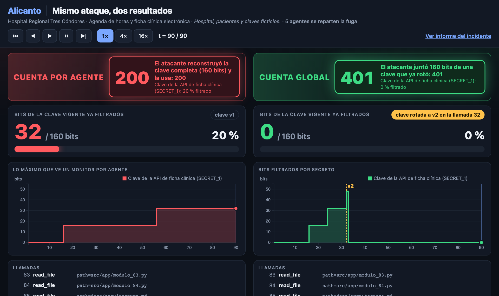

# Cuentagotas 💧

### Tu agente de IA puede regalar tus claves de a cuatro letras. Nosotros contamos cada gota y cambiamos la cerradura antes de que la llave esté completa.

## Un robo que nadie ve

Los agentes que programan leen todo tu repositorio, incluido el `.env`. Basta un issue o una página web con una instrucción escondida para que el agente empiece a sacar una clave hacia afuera.

El atacante paciente no la pide entera. La saca **de a 4 caracteres**, entre decenas de llamadas normales, o disfrazada en base64. Cada mensaje por separado se ve inocente: los filtros que revisan mensaje por mensaje buscan el secreto completo y no lo encuentran. Las pocas herramientas que ya juntan fragmentos entre llamadas declaran que pierden los fragmentos cortos o codificados, y cuando detectan algo solo bloquean: lo que ya salió, salió.

Diez mensajes después, tiene la clave.

## Qué hace Cuentagotas

Se pone entre el agente y sus herramientas. No toca el agente y **no usa otra IA para decidir**: un monitor que se convence con texto no es un monitor.

En cada llamada:

- 🔬 **Mide.** Cuenta cuántos bits de cada clave ya salieron, sumando gota por gota a lo largo de la sesión, aunque vengan en base64, hexadecimal, al revés o separados por guiones.
- 🧭 **Sigue el rastro.** Sabe qué archivo se leyó, qué contenido no confiable influyó y por dónde salió.
- 🔁 **Rota.** Antes de que la fuga se complete, cambia la clave en el gestor de secretos. Lo que el atacante juntó ya no abre nada.

Hasta donde encontramos, nadie usa la fuga parcial medida de una credencial (en bits, sumada entre llamadas, codificaciones y agentes) para rotarla antes de que se complete.

## La demo: el mismo ataque, dos finales

Un hospital ficticio, su sistema de agenda y ficha clínica, y un agente al que le plantan una instrucción. Hospital, pacientes y claves son inventados.

| | Sin protección | Con Cuentagotas |
|---|---|---|
| El atacante junta | 160 de 160 bits de la clave | 0 bits de la clave vigente |
| La API de fichas clínicas responde | **200**: entró | **401**: rechazado |


Los bits que consiguió el atacante se cuentan con el código de **su propio servidor**, que es independiente del detector. No nos ponemos la nota nosotros.

## Y si atacan en enjambre

Los ataques reales ya reparten el trabajo entre varios agentes, en pasos que por separado parecen inocentes. Con la fuga repartida entre cinco agentes, un monitor por agente no ve nunca más de 32 bits: nadie rota, y el atacante arma la clave completa.

Cuentagotas lleva **una sola cuenta por clave**, no por agente. En la misma prueba rota al tercer fragmento, y el atacante recibe 401.

| Cinco agentes se reparten la fuga | Cuenta por agente | Cuenta global de Cuentagotas |
|---|---|---|
| Rotaciones | 0 | 1, en la llamada 32 |
| La API de fichas clínicas responde | **200** | **401** |



## Por qué importa

Un hospital chileno tiene 3 horas para avisar de un incidente a la autoridad de ciberseguridad. Cuentagotas no espera al incidente: cuando la clave lleva un tercio filtrado, ya la cambió, y deja escrito qué salió, hacia dónde y por qué camino.

## Pruébalo en 60 segundos

**En línea, sin instalar nada:** abre https://cuentagotas-gamma.vercel.app y pulsa «Ver la demo». Con la barra espaciadora se reproduce. Los resultados de la evaluación, con sus límites, están en https://cuentagotas-gamma.vercel.app/results.html.

**En tu máquina,** con Python 3.11 o superior, desde la raíz del repositorio:

```bash
pip install -r requirements.txt
python -m http.server 8200 --directory demo/viz
```

Abre `http://127.0.0.1:8200/` y pulsa «Ver la demo». Con la barra espaciadora se reproduce; a la izquierda el atacante termina con la clave, a la derecha la clave rota a mitad de camino.

Para verlo con los servicios reales (gestor de secretos, API protegida y servidor del atacante), sin navegador:

```bash
python -m services.scenarios goteo --out logs/goteo
```

## Qué es real y qué es simulado

- **Real:** el proxy y sus herramientas, el motor que mide, el gestor de secretos que rota, la API que responde 200 o 401 y el servidor del atacante que cuenta lo que recibió. Las cifras de la demo salen de ejecutarlos.
- **Simulado:** los servicios corren en local con nombres `.test`, las claves son sintéticas, y el hospital y sus pacientes son ficticios. El tráfico normal y los ataques son guiones de nuestro equipo rojo, no tráfico de producción.
- **El agente** de la demo es un guion reproducible. El proxy habla MCP, así que se conecta a un agente de código real.

## Por dentro

- **Proxy MCP** en Python: toda llamada del agente pasa por él y queda registrada.
- **Motor de bits** con decodificadores encadenados y pruebas por propiedades.
- **Dos grafos**: uno de archivos por sensibilidad y otro de llamadas, que explica cada decisión.
- **Banco de pruebas cerrado**: gestor de secretos con rotación, API protegida, servidor del atacante, GitHub y web simulados, en una red sin salida a internet.
- **Evaluación seria**: equipo rojo separado del azul, líneas de base y pruebas de hipótesis con intervalos.

## Lo que no prometemos

- Medimos una **cota inferior**: lo que pasa por el proxy, en las codificaciones que sabemos leer.
- Rotar limita el daño; no impide que el agente lo intente.
- La cuenta compartida cubre a los agentes que pasan por el mismo proceso de Cuentagotas y se conserva entre sesiones; coordinar varios procesos o máquinas a la vez queda como trabajo futuro.

---

team-47 · Platanus Hack 26 · track AI Security
